# DAB Fitness

DAB Fitness connects people with fitness trainers. Users browse trainers by
category, book in-person sessions, follow workout videos and join live video
classes. Trainers manage their bookings and host live classes from their phone.

Built with Flutter, Firebase (Auth + Realtime Database) and Agora.

<p>
  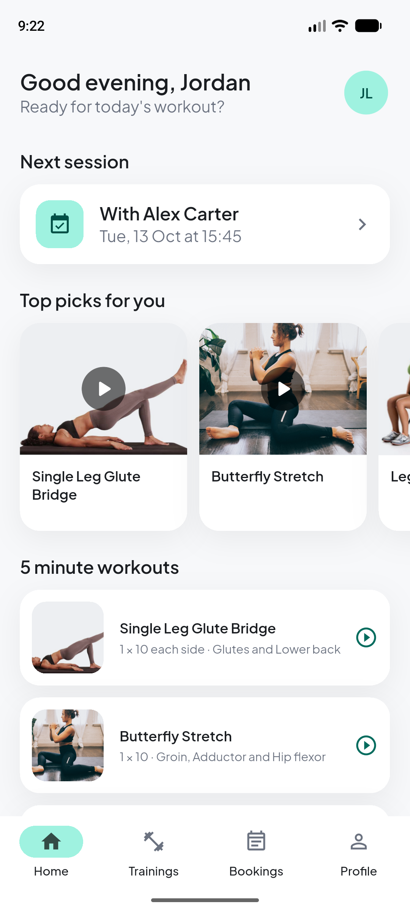
  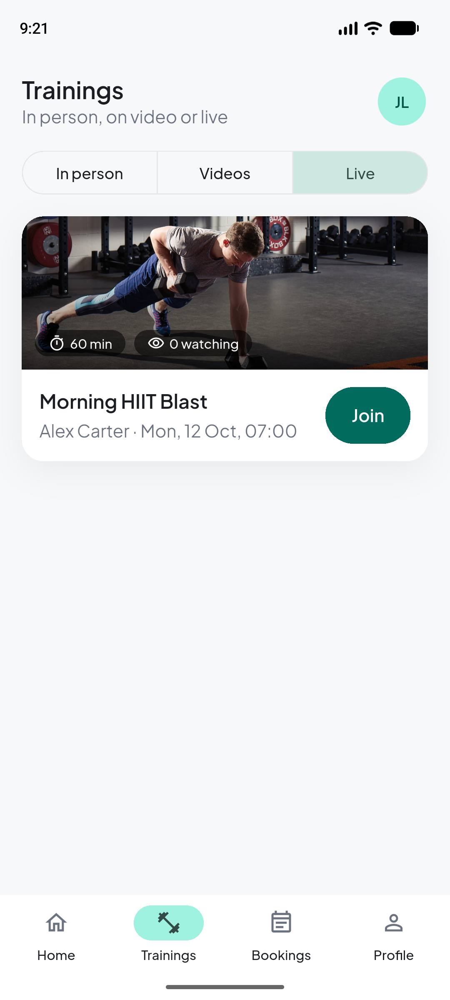
  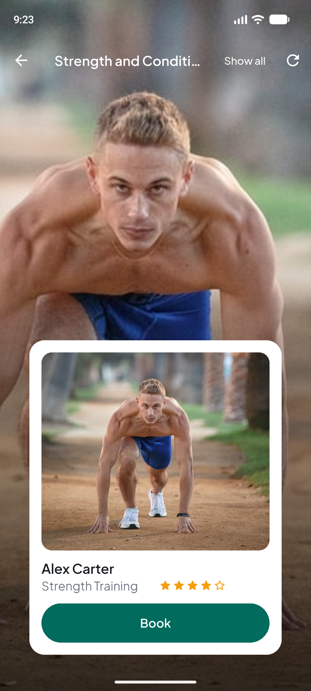
  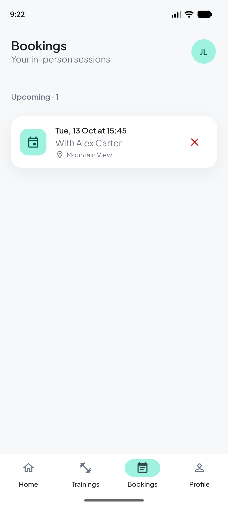
</p>

## Features

**For users**
- Sign up, log in (the session is remembered), reset a forgotten password.
- Home: a greeting, your next session, top picks and five-minute workouts.
- Trainings: pick a category to see matching trainers, watch workout videos,
  or join a live class (classes that are on now show a **LIVE** badge and a
  live "watching" count).
- Book an in-person session. Times in the past and slots that are already
  taken are refused.
- Bookings grouped into Today, Upcoming and Past, with cancellation.
- Profile with editing, and light and dark themes that follow the system.

**For trainers**
- See and cancel the sessions clients have booked.
- Schedule live classes (30/45/60/90 minutes) and host them as the broadcaster.
- Pick a speciality from the same categories users browse, so they find you.

## Screenshots

| | | | |
|---|---|---|---|
| 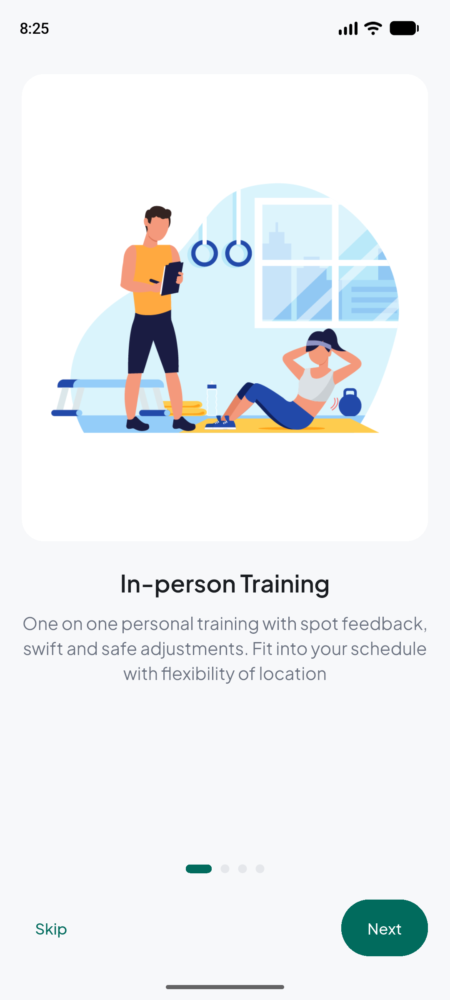 | 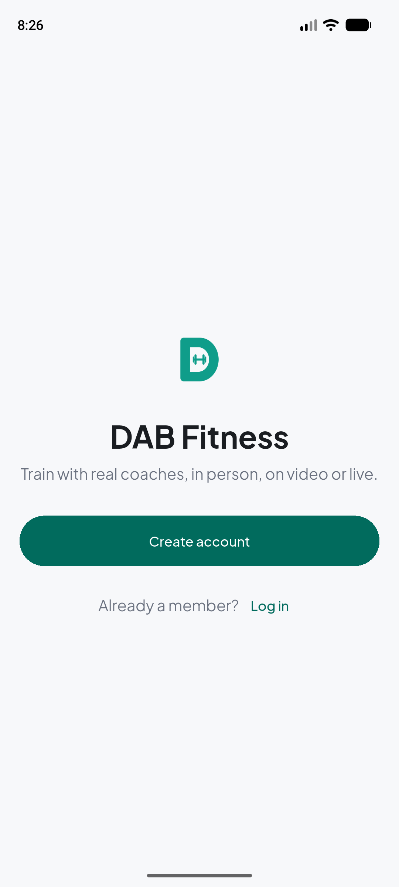 | 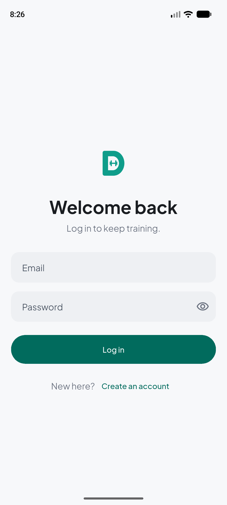 | 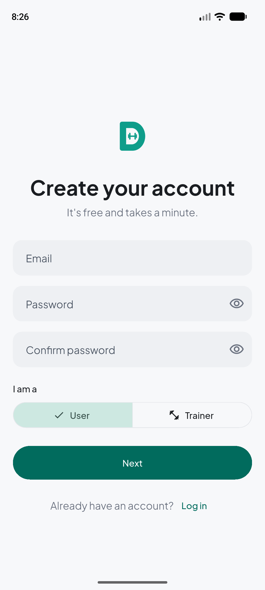 |
|  | 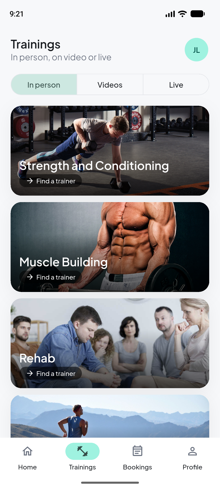 | 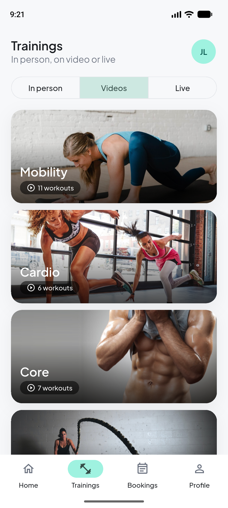 |  |
|  | 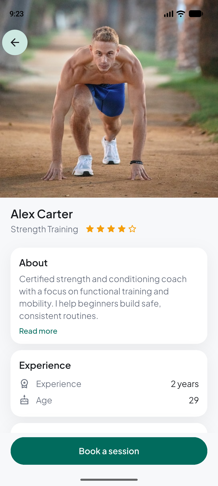 | 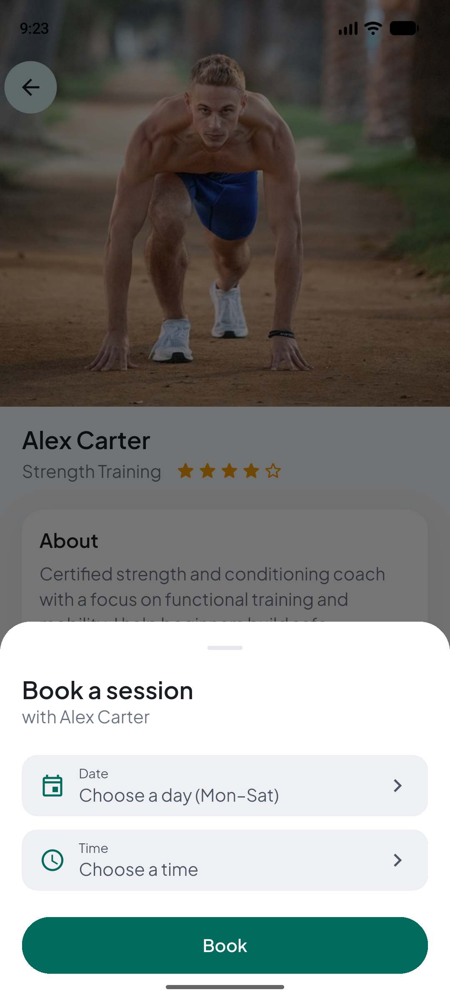 | 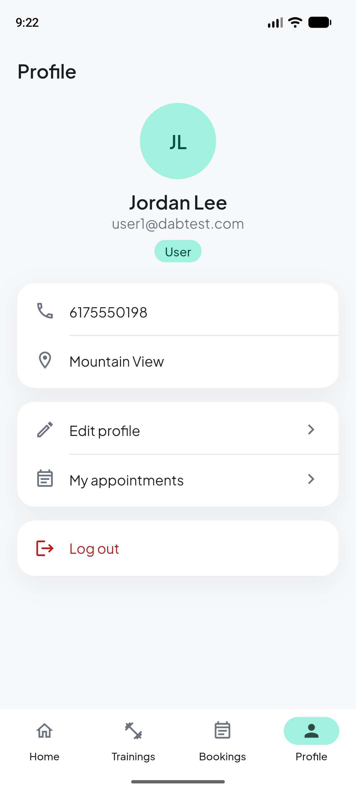 |

**Trainers**

| | | | |
|---|---|---|---|
| 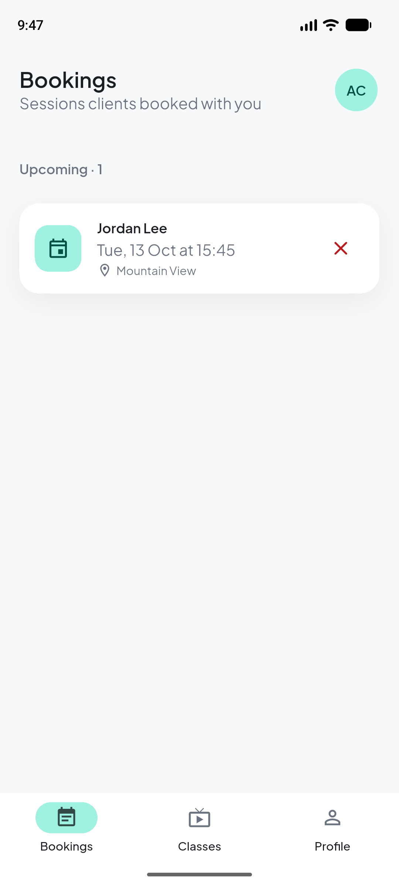 | 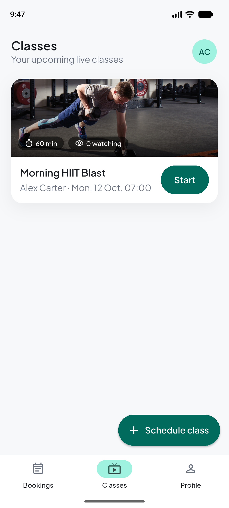 | 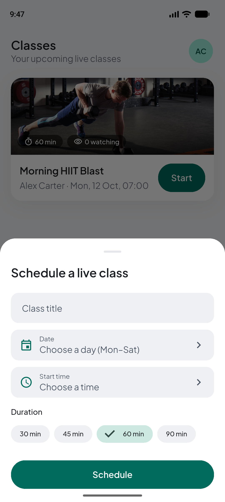 | 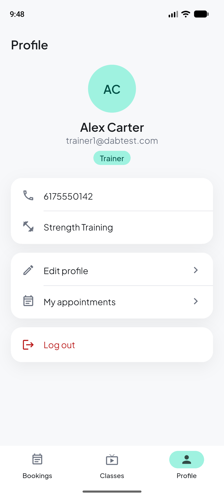 |

**Dark mode** (follows the system setting)

| | | | |
|---|---|---|---|
| 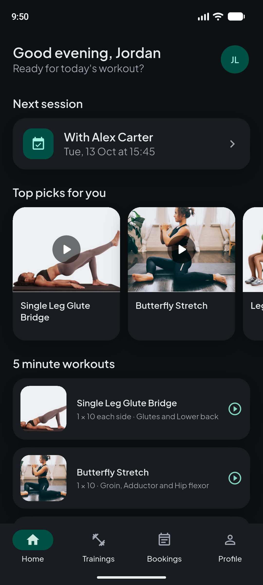 | 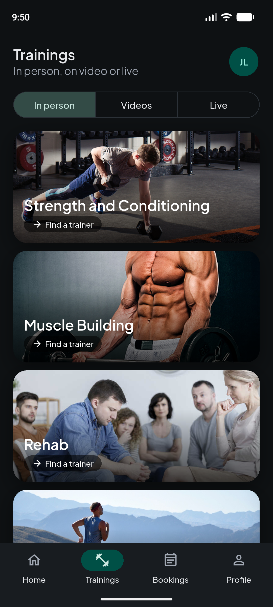 | 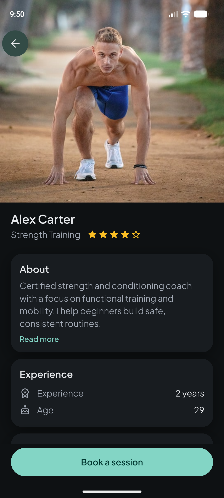 | 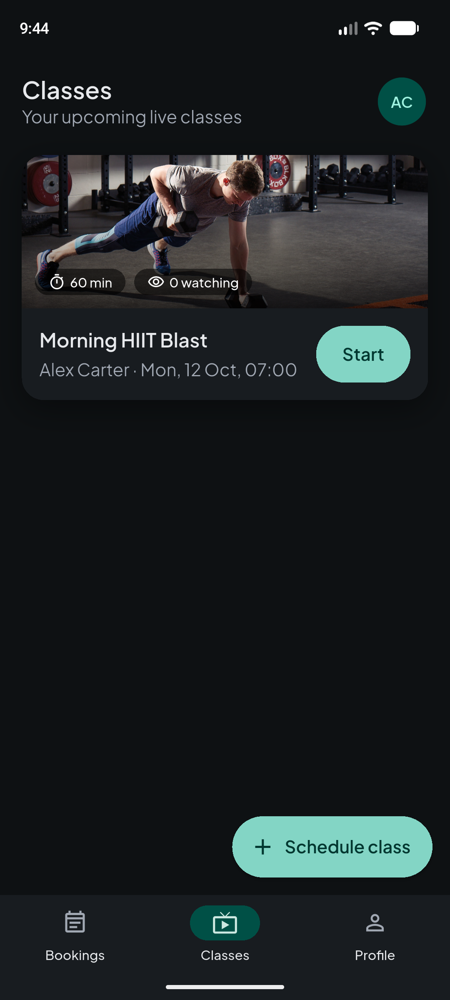 |

All screenshots, light and dark, are in [`docs/screenshots/`](docs/screenshots/).

## Tech stack

| | |
|---|---|
| App | Flutter 3.47 / Dart 3.13, Material 3, `provider` for state |
| Backend | Firebase Authentication (email/password), Firebase Realtime Database |
| Video | Agora RTC (`agora_rtc_engine` 6.x): trainers broadcast, users watch |
| Design | One design system in `lib/config/theme.dart`; Plus Jakarta Sans bundled |
| Quality | `flutter analyze` clean; unit, widget, layout and accessibility tests; GitHub Actions |

```
lib/
  config/      theme, Agora config, onboarding strings
  models/      UserProfile, Trainer, Booking, LiveClass, workouts (+ JSON)
  services/    AuthService, DatabaseService (all Firebase access)
  providers/   AuthModel, DatabaseModel, BookingModel (state for the UI)
  screens/     onboarding, auth, shell (bottom navigation), home, training,
               trainers, bookings, trainer_home, live_class, profile
  widgets/     shared components (cards, lists, sheets, empty states, ...)
  data/        bundled workout and category data
```

## Getting started

### 1. Prerequisites
- Flutter 3.47 (stable) and an Android SDK with an emulator or device.
  iOS is configured but hasn't been built yet; see "iOS" below.

### 2. Firebase
1. Create a Firebase project and enable **Authentication → Email/Password**
   and the **Realtime Database**.
2. Connect the app with the FlutterFire CLI:
   ```bash
   flutterfire configure --project=<your-project-id> --platforms=android,ios
   ```
   This writes `lib/firebase_options.dart` and `android/app/google-services.json`.
3. Publish the security rules in [`database.rules.json`](database.rules.json),
   either in the console or with:
   ```bash
   firebase deploy --only database
   ```

### 3. Agora (live classes)
The app joins calls with an App ID and no token, which only works for an
Agora project in testing mode (see [Known limitations](#known-limitations)).
Put the App ID in a local config file:
```bash
cp config/env.example.json config/env.json
```
and put your App ID in `config/env.json`. That file is git-ignored; never
commit real keys. Without it the app still runs, but live classes say the
App ID is missing.

### 4. Run
```bash
flutter run --dart-define-from-file=config/env.json
```
In VS Code, the **DAB Fitness (debug)** launch configuration adds the flag for you.

### 5. Test
```bash
flutter analyze
flutter test
```
CI runs the same checks (plus `dart format`) on every push and pull request;
see [`.github/workflows/ci.yml`](.github/workflows/ci.yml).

### iOS
`ios/` was regenerated for Flutter 3.47 (iOS 15+), but hasn't been built on a
Mac yet. To finish it there: run `pod install`, add `GoogleService-Info.plist`,
and enable the camera, microphone and location permissions for
`permission_handler` in the Podfile.

## Known limitations

- **Live video calls need an Agora token server.** The app currently joins
  calls with only an App ID and an empty token, which works only for Agora
  projects in testing mode. New Agora projects require Secure mode, where
  every join needs a token issued by a server, so live classes won't connect
  with a newly created project. A token server is planned.

## From 2021 to 2026

DAB Fitness began in 2021 as a team project that won the **LICET Pattarai
hackathon**. The original app is kept untouched on the `master` branch; it
was written for pre-null-safety Flutter.

In 2026 it was migrated and rebuilt, one phase at a time, with the app
building and running after every step:

1. **Migration.** Moved to Flutter 3.47 and Dart 3 null safety, replaced
   discontinued packages, rewrote the video call page for Agora 6, and fixed
   the Android build for current SDKs.
2. **Structure.** Renamed the package to `dab_fitness`, adopted a
   `config / models / services / providers / screens / widgets` layout, and
   cleared every analyzer warning.
3. **Firebase.** Replaced hand-written REST calls with the official
   FlutterFire packages, added persistent login, typed models, and moved
   secrets out of the source.
4. **Missing features.** Real booking cancellation, double-booking
   protection, trainer logout, profile editing, finishing an interrupted
   sign-up, live class durations and attendee counts, and pull-to-refresh
   with proper empty and error states everywhere.
5. **Design.** A "clean and light" design system with dark mode, bottom
   navigation for users and trainers, every screen restyled, a new app icon
   and splash, and tests that enforce the design tokens, WCAG AA contrast and
   48 px tap targets.

## Credits

- The 2021 original was built as a team project for the LICET Pattarai
  hackathon, where it won.
- The 2026 migration and rebuild is by **Eroniction Presley**.
- [Plus Jakarta Sans](https://github.com/tokotype/PlusJakartaSans) is used
  under the SIL Open Font License 1.1
  (see `assets/fonts/plus_jakarta_sans/OFL.txt`).
